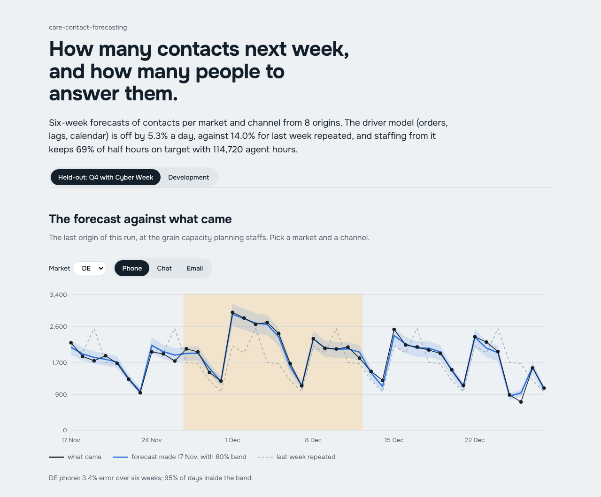
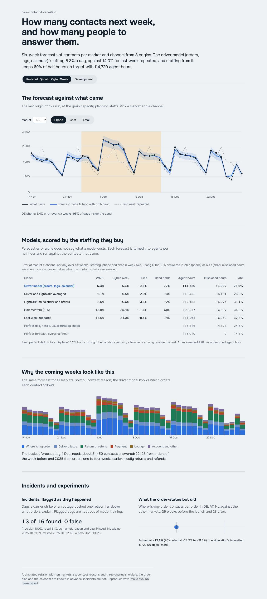
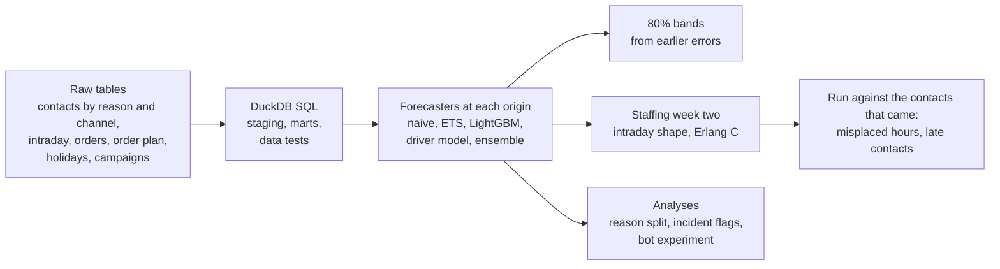

# care-contact-forecasting

[](https://github.com/manojrevenkar12-web/care-contact-forecasting/actions/workflows/ci.yml)

Customer-care contact volumes forecast for a multi-market online fashion retailer, the way a workforce-management
forecasting team needs them:
- **at the right grain:** six weeks ahead, per day, for each market and channel (phone, chat, email), built up from
  contact reasons;
- **driven by orders:** where-is-my-order contacts follow orders by a few days, returns and refunds by two to four
  weeks, and the commercial order plan and the campaign calendar are known in advance;
- **scored by the staffing they buy:** each forecast becomes agents per half hour with Erlang C, the way capacity
  planning would schedule week two, and is run against the contacts that actually came.

Around the forecast sit the analyses operations asks for:
- why next week looks the way it does;
- which days an incident pushed volumes far above what orders explain;
- what the order-status bot did, read as a natural experiment.



**On the held-out quarter (October to December 2025, Cyber Week included, eight origins run once):**
- **Accuracy:** the driver model was off by **5.3%** a day at market × channel, against **14.0%** for last week
  repeated. In the Cyber Week period it was off by **5.6%** against 24.0%.
- **Staffing:** week two staffed from it misplaced **15,092** agent hours, against 16,950 for the naive forecast and
  14,178 for *perfect* daily totals put through the usual intraday shape. That removes about two-thirds of the
  misplacement a forecast can fix at all.
- **Incidents:** 13 of 16 incident days were flagged as they happened, with no false alarms.
- **The bot experiment:** the bot's effect was estimated at −22.2% against a true −22%.

## Results

All numbers come from `make eval`, `make heldout` and `make report` (`reports/*.json`).

| Term | Meaning |
|---|---|
| Error (WAPE) | Absolute error over actual contacts, at market × channel per day, over all six weeks from every origin |
| Hours misplaced | Agent hours staffed above or below what the contacts that came needed, phone and chat, week two |
| Answered late | Share of contacts not answered within the target (80% in 20 s for phone, 60 s for chat) |

### Held-out: the first and only run (commit `e15d14b`, 8 origins, 2025-09-29 to 2025-11-17)

| Model | Error (WAPE) | Cyber Week period | Bias | 80% band holds | Agent hours, week two | Hours misplaced | Answered late |
|---|---|---|---|---|---|---|---|
| **Driver model (orders, lags, calendar)** | 5.3% | 5.6% | -0.5% | 77% | 114,720 | 15,092 | 26.6% |
| Driver and LightGBM averaged | 6.1% | 6.5% | -2.0% | 74% | 113,452 | 15,101 | 28.8% |
| LightGBM on calendar and orders | 8.0% | 10.6% | -3.6% | 72% | 112,152 | 15,274 | 31.1% |
| Holt-Winters (ETS) | 13.8% | 25.4% | -11.6% | 68% | 109,946 | 16,096 | 35.0% |
| Last week repeated | 14.0% | 24.0% | -9.5% | 74% | 111,964 | 16,950 | 32.8% |
| Perfect daily totals, usual intraday shape | | | | | 115,346 | 14,178 | 24.6% |
| Perfect forecast, every half hour | | | | | 115,040 | 0 | 14.3% |

- **Incidents flagged as they happened:** 13 of 16 found, 0 false alarms (precision 100%, recall 81%). The
  three-day NL carrier strike in October was missed.
- **Order-status bot, difference in differences:** −22.2% (95% interval −23.2% to −21.3%); the true effect is −22%.

### Development (22 origins, January 2024 to August 2025; the model and every setting were chosen here)

| Model | Error (WAPE) | Cyber Week period | Bias | 80% band holds | Agent hours, week two | Hours misplaced | Answered late |
|---|---|---|---|---|---|---|---|
| **Driver model (orders, lags, calendar)** | 5.0% | 5.8% | +0.1% | 78% | 287,132 | 37,582 | 25.7% |
| Driver and LightGBM averaged | 5.3% | 7.2% | -0.2% | 79% | 286,443 | 37,607 | 26.1% |
| LightGBM on calendar and orders | 6.5% | 12.7% | -0.5% | 80% | 285,694 | 38,083 | 26.7% |
| Holt-Winters (ETS) | 9.4% | 20.5% | -0.9% | 78% | 284,923 | 38,990 | 27.3% |
| Last week repeated | 13.1% | 23.2% | +1.1% | 80% | 289,312 | 44,502 | 25.9% |
| Perfect daily totals, usual intraday shape | | | | | 288,548 | 36,230 | 23.9% |
| Perfect forecast, every half hour | | | | | 287,785 | 0 | 14.2% |

Incidents: 15 of 16 found, 0 false alarms. The gate (`config/forecast.toml`) passed on both:

| The chosen model must | Required |
|---|---|
| Error | at most 0.85 × the naive model's |
| Misplaced hours | at most 0.90 × the naive model's |
| 80% band | holds on 72–88% of days |
| Incident flags | precision and recall of at least 80% |



## What the analysis taught

- **Simple, explainable and right beats clever here.** The driver model wins at every horizon. It is a regression
  of contacts on lagged orders per market and reason, with weekday and holiday factors. It knows that a Cyber Week
  order turns into a where-is-my-order contact four days later and a return two weeks later; repeating last week
  cannot know that. Averaging it with LightGBM made it slightly worse, so the simpler model was chosen.
- **The planner's question is hours, not percentages.** The naive model looks cheap on hours (111,964), but only
  because it under-forecast the Q4 rise by 9.5%. That shows up as 32.8% of contacts answered late, against 26.6%.
- **Not all misplacement is forecastable.** Even a perfect daily forecast misplaces 14,178 hours, because the
  half-hour pattern varies day to day. Beyond the daily forecast, the next lever is the intraday shape (a re-forecast
  during the day), not a better daily model.
- **Incidents are spikes; drops are something else.** The first incident detector flagged anything far from the
  driver fit, which caught the bot's lasting drop and holiday quirks: precision was 25%. Flagging only days well
  above what orders explain gave 100% precision, and the flagged days are kept out of model training.
- **A launch is an experiment if you read it as one.** Where-is-my-order contacts per order in the bot markets,
  against the others, before and after, give −22.2%. Comparing the bot markets before and after alone would have
  folded in everything else that changed in those weeks.

## How it works



- **Data** (`src/ccf/etl/sql`): staging, marts and five data tests in SQL on DuckDB:
  - one row per series and day;
  - no negative counts;
  - a plan for every order day;
  - intraday counts that add up to the daily ones;
  - complete series.

  Python reads only the marts. The marts are plain tables, ready for a BI tool.
- **Forecasters** (`src/ccf/models/forecasters.py`). Each one reads contacts before its origin, the order plan and
  the calendar. A test shows a forecast does not change when everything after the origin is tripled.
  - **Driver model:** non-negative regression of contacts on lagged orders, recency-weighted, with weekday, holiday
    and after-holiday factors and a short-run level correction; split by the recent channel mix.
  - **LightGBM:** one global model on calendar and order-lag features.
  - **ETS:** Holt-Winters with a weekly season and a damped trend.
- **Staffing** (`src/ccf/staffing`):
  - Erlang C, vectorised. A test reproduces the textbook case: 20 Erlangs need 25 agents for 80/20.
  - Chat agents handle two chats at a time.
  - Agents needed for the contacts that came are compared with agents planned from the forecast.
- **Analyses** (`src/ccf/analysis/insights.py`):
  - each forecast day split by reason, and into orders of the last week against older orders (the returns wave);
  - incident flags from robust z-scores of the driver fit's residuals;
  - difference in differences with a weekly block bootstrap.

## Mapped to the role (Data Analyst – Forecasting, Customer Care workforce management)

| The role asks for | Where it is here |
|---|---|
| Own the contact-volume forecast for internal teams and outsourcing partners | Six-week daily forecasts per market and channel, from contact reasons, scored where capacity planning uses them |
| Statistical analysis and ML for time-series forecasts, accuracy, reliability, explainability | Five models on rolling origins, 80% bands calibrated on earlier errors, a driver model whose every number traces to orders |
| Experiments: methodology and metrics | The bot read by difference in differences with a block bootstrap; staffing outcomes as the metric |
| Reporting and visualization for management and operations | The dashboard, the reason split, marts ready for a BI tool |
| Driver analysis, anomaly detection, simulation | Order-lag drivers, incident flags, Erlang C staffing run against the contacts that came |
| Python, SQL, GitHub CI/CD | Python, DuckDB SQL with data tests, GitHub Actions |
| When to build a pipeline and when a spreadsheet is enough | The simple driver model was chosen over the ensemble |

## Run it

```bash
pip install -e ".[dev]"     # Python 3.11+
make data                   # the world, the warehouse and its data tests (~10 s)
make test                   # 10 tests (~30 s)
make eval && make report    # development backtest (~10 min), README tables, dashboard data
cd web && npm ci && npm run dev
```

## The held-out rule

The world and the eight held-out origins are pinned in `config/heldout.lock`. The chosen model and every setting
were fixed on development origins, and the held-out run happened once (`make heldout` refuses to overwrite
`reports/heldout.json`). [docs/heldout-exposure.md](docs/heldout-exposure.md) records what was seen of the period
before the run: a sanity check of total daily contacts around Cyber Week 2025 when the world was generated.

## Limits

- **The retailer is simulated.** Markets, orders, contact rates, lags, incidents and the bot are generated, and the
  world is cleaner than real customer care: no backlog carry-over, no repeat contacts, no channel steering. What
  transfers is the method and how each choice is scored, not the size of each number.
- **Email is forecast but not staffed.** It is answered from a backlog, not by Erlang C.
- **Staffing stops at productive agents.** There is no shrinkage, scheduling or shift constraints, and the
  €28-per-hour figure is an assumption.
- **Plain Python and DuckDB.** No Databricks, Airflow or BI tool runs here; the marts are where a Looker or Power BI
  model would sit.

## Layout

```
config/            world.toml, forecast.toml, heldout.lock
src/ccf/world/     the simulated retailer and its truth (only the backtest reads it)
src/ccf/etl/       SQL staging, marts and data tests on DuckDB
src/ccf/models/    the forecasters
src/ccf/staffing/  Erlang C and the week-two staffing evaluation
src/ccf/analysis/  reason split, incident flags, the bot experiment
src/ccf/evals/     the backtest and the gate
web/               the dashboard (React, Framer Motion)
```
